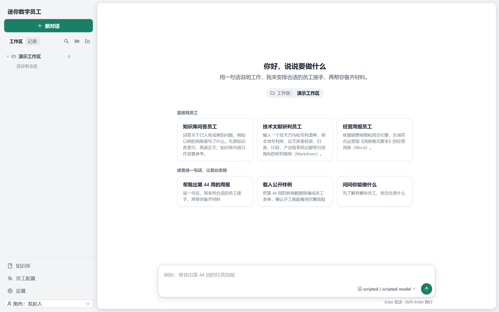
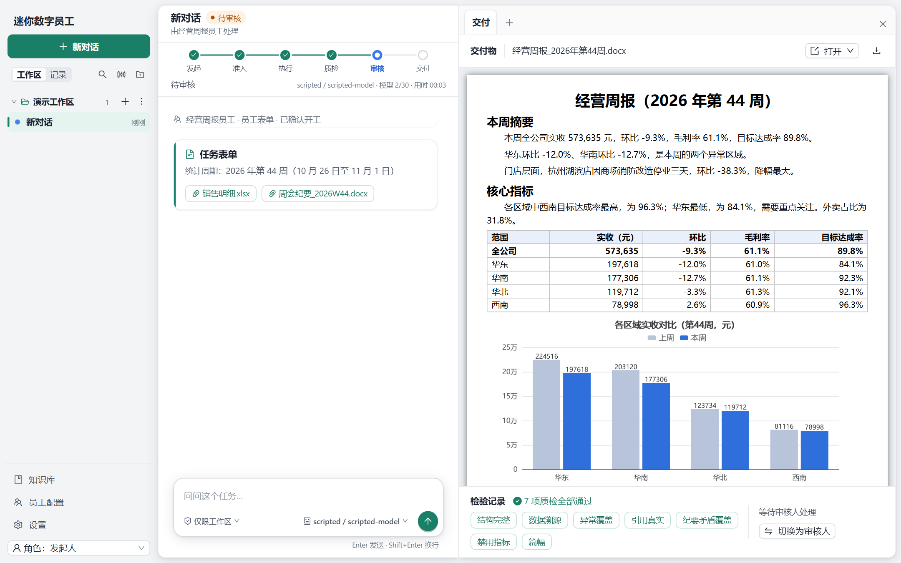

# 迷你数字员工

> 能接收岗位任务、调用工具产出交付物、交付前接受人工审核的数字员工系统。
> 工作流程由程序编排，模型只在判断步骤里工作；一个员工一套配置，换配置就换岗位。

首个落地的岗位是**经营周报员工（场景 A）**：发起人在对话里说明要做什么，前台 Agent（一个通用的对话 Agent）从对话和工作区目录的文件里整理出员工的输入，调用员工工具 `run_employee`，弹出一张**员工表单**让发起人核对、补充、确认；确认开工后，系统依次完成准入校验 → 读取数据 → 计算指标 → 解析纪要 → 匹配异常原因 → 撰写报告 → 生成 Word → 质检（不通过自动修正）→ 等待审核；审核人可通过交付，或退回重做。全流程有事件日志，进程被杀后可从断点恢复。

工作区就是电脑上的一个文件夹：会话和任务属于某个工作区，所有工作区同时可用、不用切换；设置、员工和知识库放在应用目录，所有工作区共用（见 [ADR-0006](docs/adr/0006-workspace-is-a-folder.md)）。一个会话里可以先后运行多个任务（同一时刻最多一个未结束），交付后会话照常能聊、能换模型、能“再来一版”；前台 Agent 能做什么由输入框左下角的**权限模式**决定（见 [ADR-0007](docs/adr/0007-general-agent-employees-as-tools.md)）。

> **评审/演示**：直接看 [快速开始](#快速开始)——打包一次 exe → 双击启动（直接打开原生窗口）→ 添加自己的模型连接 → 跑任务。逐项真实模型验收见 [真实模型手动测试指南（Spec 0007）](docs/manual-test-0007.md)。

<p align="center"></p>

<p align="center"></p>

> 上面是真实运行的界面截图（剧本式假模型，不联网；数据是公开样例）。更多：[任务步骤与详情](docs/screenshots/03-task-steps.png) · [工具故障暂停与重试](docs/screenshots/04-tool-failure.png) · [场景 B 研判简报](docs/screenshots/05-review-literature-brief.png) · [工作区文件浏览](docs/screenshots/06-workspace-files.png)。

## 亮点

- **程序编排步骤，模型只做判断**：计算步骤直接调工具，判断步骤（原因匹配、写报告、解读退回意见）才交给模型，模型在轮次与时长上限内运行 —— 见 [ADR-0001](docs/adr/0001-program-orchestrated-steps.md)。
- **数字和引用只走槽位**：正文里的数字与原文引用由程序从事实和纪要填入，模型写错会被质检抓出 —— 见 [ADR-0002](docs/adr/0002-facts-via-slots.md)。
- **质检不通过自动修正**：结构完整、数据溯源、异常覆盖、引用真实、纪要矛盾覆盖、禁用指标、篇幅 7 项检查，退回重做后再加“意见响应”共 8 类，按 `fixStep` 重跑对应步骤，次数用尽才转人工。质检按员工配置的**质检档**（`qc.yaml` 的 `profile`）选检查：周报是上面这一套，技术文献研判简报是另一套（见场景 B）。
- **两个业务员工，换配置就换岗位**：场景 A 经营周报员工（Word）和场景 B 技术文献研判员工（Markdown），共用同一个引擎、状态机、工具注册表和质检框架；差别全在员工目录里的配置（流程、提示词、输出 Schema、质检参数、自带资料）。
- **JSONL 事件日志 + 断点恢复**：每个任务 `events.jsonl` 追加写；重启后重放事件、只重跑未完成步骤；支持命令行回放。
- **右栏标签页**：右栏（右上角 × 可整体关闭）像浏览器一样有标签页——默认页是“交付”（交付物预览、检验记录、审核、放入知识库、早先的交付），“任务步骤”里点一步就在下面看这一步做了什么（工具调用、模型轮次、质检、暂停与重做），“工作区文件”可以浏览、预览工作区里的文件夹和文件；后两页点“+”才打开，都只读，不提供推进操作。交付物右上角可用 Word 等本机应用打开。对话里只留员工的工具卡片（员工表单卡等）和要人答复的确认。
- **工作区就是目录**：工作区只是名字加一个本机目录，侧栏同时列出所有工作区和它们下面的会话；取消登记只删登记，目录里的文件、会话和任务都保留；设置、员工和知识库存在应用目录，所有工作区共用 —— 见 [ADR-0006](docs/adr/0006-workspace-is-a-folder.md)。
- **设置里不预置任何厂商**：全新安装时没有任何模型连接，由人自己“添加连接”（名称、地址、Key，任何 OpenAI 兼容的服务都行），再从 `{baseUrl}/models` 拉取模型并勾选。Key 只来自设置里填写的内容，不会被环境变量覆盖。
- **会话里选模型**：输入框右下角按会话选模型，新对话页也能选；新会话沿用上次选择；任何状态（含已交付、已终止）都能换，任务运行中切换从下一个判断步骤生效；轨迹和步骤行标出每步用的模型。
- **通用对话 Agent，员工是它能调用的工具**：前台 Agent 有文件工具（`list_files` / `read_file` / `find_files` / `search_content` / `write_file` / `edit_file`）、`todo_write`、`ask_user_question`、命令行工具 `shell`，和 `run_employee`。它把员工需要的字段和材料整理好，弹出**员工表单卡**（标出哪些字段是它预填的、材料来自哪里），人核对后点“确认开工”，或点“不是这个员工”让它换人 —— 取代原来的“确认员工、开工清单、提交”三张卡（见 [ADR-0007](docs/adr/0007-general-agent-employees-as-tools.md)）。
- **权限模式**：仅可查看 / 仅限工作区 / 完全权限三档，每个会话各自记住、新会话总是从“仅限工作区”开始；管 Agent 写文件、运行员工、把目录文件用作材料、运行命令要不要先问人，审核、重试、终止、开工清单确认仍然只有人能做（详见下文「前台 Agent、权限模式与员工当工具」）。
- **一个会话多个任务**：交付或终止后会话继续可用，可以接着聊、换模型、说“再来一版”开第二个任务；侧栏状态点按最新任务算，“记录”里每个任务单独一行。
- **工具在进程内调用**：Go 主进程直接调用工具，不另起 stdio 子进程；内置故障注入（超时 / 报错 / 非法输出），可现场演示工具故障与重试。
- **权限在服务端校验**：发起人 / 审核人 / 操作员三种角色，越权操作被拒绝并留痕，状态机之外的流转一律拒绝；Agent 的写操作另有权限模式和固定边界（只限工作区目录内，不能写隐藏文件和“交付”“材料”文件夹；**例外：`shell` 命令行工具没有沙箱**，不受这些边界约束，只受权限模式管，见下文与 [ADR-0007 增补](docs/adr/0007-general-agent-employees-as-tools.md)）。
- **单文件 exe**：把服务端、前端构建产物、员工配置和公开样例打进一个 exe；双击即用，首次启动建应用目录 `%APPDATA%\digital-employee-app`（`DE_APP_DIR` 可改：设置、员工、知识库、会话和任务都在这里），以及默认工作区「我的工作区」（`文档\数字员工`）；端口冲突自动换端口 —— 见[设计文档 §14](docs/design.md)、[ADR-0006](docs/adr/0006-workspace-is-a-folder.md)。
- **原生桌面窗口，双击即用**：同一个 Go 主进程内嵌服务端（只监听 `127.0.0.1`），原生窗口（MyGo + 系统 WebView2）加载本机地址；exe 用 GUI 子系统构建，双击没有控制台窗口，窗口关闭程序即退出；单实例、记住窗口大小位置、日志写文件、启动失败弹消息框；想用浏览器就加 `--browser` —— 见下文「启动软件」与 [ADR-0004](docs/adr/0004-go-mainline.md)。
- **Go 后端 + React 前端**：后端 Go（`net/http` + SSE），前端 React/Vite + antd；契约类型在 `internal/contract`（Go 版唯一事实来源），前端用 `packages/core/src/contract` 的 TS 类型，字段名逐字段一致。

## 目录结构

```
digital-employee/
├── cmd/digital-employee/   Go 单 exe 入口：子命令分派与真实接线
├── internal/               Go 后端
│   ├── contract/           契约唯一事实来源（事件、状态、设置、配置；前端 TS 类型在 packages/core/src/contract）
│   ├── config/  engine/  qc/  agent/  tools/  render/   配置、引擎、质检、模型、工具、Word 渲染
│   ├── server/  session/    REST + SSE、角色权限、会话与前台 Agent
│   ├── app/  desktop/  cli/ 应用目录与工作区准备、原生窗口、命令行
├── packages/web/           React 前端（会话、步骤行与轨迹、发起、审核、配置、设置）
├── packages/core/          前端契约类型（src/contract，与 internal/contract 逐字段一致）
├── employees/
│   ├── weekly-report/      场景 A 员工配置（提示词、输出 Schema、流程与质检配置）
│   ├── literature-brief/   场景 B 技术文献研判员工（配置 + library/ 专利库与论文库 + routes.yaml 路线词表）
│   └── knowledge-qa/       知识库问答员工（只有一个判断步骤）
├── samples/
│   ├── scenario-a/         样例数据（销售明细、周会纪要、格式要求）
│   ├── scenario-b/         场景 B 样例数据（专利库、论文库、三份业务方清单、格式要求、公开样例用例）
│   └── cases/              43 条命令行用例（A / S / T / B 系列）及其剧本式假模型输出
├── scripts/                构建与冒烟：build-exe.ps1、build-go.ps1、smoke-exe.ps1、smoke-go.ps1 等
├── docs/                   设计文档、架构图、术语表、ADR、工单、界面稿
└── README.md
```

## 快速开始

> 评审演示只要三步：**打包一次 exe → 双击启动 → 在弹出的窗口里用**。使用者不需要安装 Go、Bun、数据库或其它运行时（Windows 10 需要已装 WebView2 Runtime，见下文排错）。

### 命令速查

PowerShell，在仓库根目录执行。前置：Windows 10 / 11 x64、Go 1.27.3+、Bun 1.4+（只有构建机需要）。

```powershell
# ── 打包成可执行文件 ──────────────────────────────────────────
$env:GOSUMDB='sum.golang.org'; $env:GOTOOLCHAIN='auto'      # 本机若关了校验库，先设这两个
bun install                                                  # 前端依赖（仅首次）
powershell -ExecutionPolicy Bypass -File scripts\build-exe.ps1   # → dist\digital-employee.exe（GUI 版，含前端构建）
#   等价写法：bun run build:exe；手动分步：bun run build:web，再 go build（见下文「1. 打包软件」）

# ── 启动 ─────────────────────────────────────────────────────
.\dist\digital-employee.exe                  # 双击同款：原生窗口（关窗即退出）
.\dist\digital-employee.exe --browser        # 用浏览器代替窗口
.\dist\digital-employee.exe --serve-only     # 只起服务端，不开窗口、不开浏览器
$env:DE_APP_DIR='D:\de-test\app'; .\dist\digital-employee.exe    # 用隔离数据启动（不碰日常数据）
$env:DE_SCRIPTED='samples\cases\scripts\A-01.json'; .\dist\digital-employee.exe   # 不填 Key 的离线演示（剧本式假模型）

# ── 从源码运行（开发）────────────────────────────────────────
bun run build:web                            # go:embed 需要 packages\web\dist
go run ./cmd/digital-employee                # 控制台版：窗口 / --browser / --serve-only 同上
bun run dev:web                              # 前端热更新（先另开一个终端 --serve-only，再设 VITE_API_TARGET）

# ── 测试 ─────────────────────────────────────────────────────
go test ./...                                # 全部后端测试（剧本模型，不联网、不要 Key）
bun test packages/web                        # 前端测试
bun run typecheck                            # 前端类型检查
powershell -ExecutionPolicy Bypass -File scripts\smoke-go.ps1    # 控制台版冒烟：A-01 + 起服务端 + SSE
```

### 1. 打包软件

**前置**（只在构建机需要）：

| 依赖 | 版本 | 确认命令 |
|---|---|---|
| Windows | 10 / 11 x64 | — |
| Go | 1.27.3+ | `go version` |
| Bun | 1.4+ | `bun --version` |

**一条命令**（在仓库根目录，PowerShell）：

```powershell
powershell -ExecutionPolicy Bypass -File scripts\build-exe.ps1
```

脚本做三件事：

1. `bun install`（缺依赖时）+ `bun run --filter @de/web build` → 前端 `packages/web/dist`（`go:embed` 会把它嵌进 exe）
2. `go build -trimpath -ldflags "-s -w -H=windowsgui -X main.appVersion=<版本>" -o dist/digital-employee.exe ./cmd/digital-employee`（`-H=windowsgui`：GUI 子系统，双击没有黑色控制台窗口；应用图标和版本信息在 `cmd\digital-employee\resource_windows_amd64.syso` 里，已入库，自动链接）
3. 打印体积和 PE Subsystem，不是 GUI(2) 就报失败。脚本**不会运行**产出的 exe（运行会弹出窗口）

产物：**`dist\digital-employee.exe`**，单文件约 **28MB**。

**手动分步**（等价，便于 CI 或自定义）：

```powershell
bun install
bun run --filter @de/web build
go build -trimpath -ldflags "-s -w -H=windowsgui" -o dist/digital-employee.exe ./cmd/digital-employee
```

- 必须先有 `packages\web\dist\index.html`，否则 `go:embed` 编译失败。
- 已有前端产物时可用 `-SkipFrontend` 跳过前端构建；`-Version` 指定版本号（缺省取 `main.go` 里 `appVersion` 的默认值）。
- 脚本会自动设 `GOSUMDB=sum.golang.org`、`GOTOOLCHAIN=auto`；手动构建时同样要设，否则可能拉不到 1.27.3 工具链。
- 构建产物 `dist\` 与 Go 缓存都不入库。
- **控制台版**：`scripts\build-go.ps1` 产出 `dist\digital-employee-console.exe`（不带 `-H=windowsgui`，另含 init + A-01 冒烟）。脚本 / CI 里要读 exe 的输出和退出码时用它（`scripts\smoke-go.ps1` 默认就测这个）；给用户的始终是 `digital-employee.exe`。
- 改了图标图案：`go run scripts\gen-icon.go`；改了版本信息或要重新生成资源：在 `cmd\digital-employee` 下 `go run github.com/tc-hib/go-winres@v0.3.3 make --arch amd64 --out resource`。

**构建环境常见问题**：

| 现象 | 处理 |
|---|---|
| `checksum database disabled` / 拉不到 Go 工具链 | 设 `$env:GOSUMDB='sum.golang.org'; $env:GOTOOLCHAIN='auto'` |
| `go:embed ... no matching files` | 先 `bun run --filter @de/web build` |
| `bun: command not found` | 安装 Bun，把 `%USERPROFILE%\.bun\bin` 加进 PATH |
| 杀毒软件拦截构建或产物 | 把仓库目录与 `dist\` 加入白名单 |
| 中文用户名目录下构建异常 | 保持仓库路径为纯 ASCII，缓存目录不要指进工作树 |

**构建后验证**（不用运行 exe）：

```powershell
# build-exe.ps1 末尾已打印：PE Subsystem：2（Windows GUI）
powershell -ExecutionPolicy Bypass -File scripts\build-go.ps1 -SkipFrontend
powershell -ExecutionPolicy Bypass -File scripts\smoke-go.ps1 -SkipBuild
# 控制台版：临时目录跑 A-01 到 delivered，再起服务端校验 /api/employees、/api/tasks、首页、前端脚本与 SSE
# 退出码 = 失败项数（0 表示通过）
```

**分发**：只用拷 `dist\digital-employee.exe` 一个文件给使用者；不需要附带仓库、Go、Bun 或数据库。

### 2. 启动软件

**双击 `digital-employee.exe`**：直接打开原生窗口（标题「迷你数字员工」，默认 1280×860，最小 960×640），没有控制台窗口，也不会打开浏览器。**关闭窗口 = 退出程序**：内嵌服务端优雅关闭，不留后台进程。

背后发生的事：

- 内嵌服务端只监听 `127.0.0.1`，端口从 8787 起自动选空闲端口（被占就往后找，最多 20 个；`--port` / `DE_PORT` 可指定起点）；窗口加载这个本机地址，与浏览器方式共用同一个应用目录。
- **记住窗口**：关闭时把大小、位置、是否最大化存到应用目录的 `window-state.json`，下次启动恢复；文件坏了或位置在屏幕外（拔了外接显示器）就回到默认大小居中。
- **外链**：窗口里的 http / https 非本机链接用系统默认浏览器打开，不在窗口里跳转。右键菜单只保留撤销 / 重做 / 剪切 / 复制 / 粘贴 / 全选 / 复制链接，没有“重新加载”“检查”“另存为”。
- **单实例**：同一个应用目录同时只运行一个实例。再次双击会把已有窗口带到前台（最小化的先还原），新进程静默退出。`DE_APP_DIR` 不同的实例互不影响，可以同时开（隔离测试数据用）。
- **日志**：没有控制台，日志写到 **`<应用目录>\logs\digital-employee.log`**（默认 `%APPDATA%\digital-employee-app\logs\`）；超过 5MB 滚动成 `.1`、`.2`、`.3`，只留最近 3 份旧文件。未捕获的崩溃输出写 `logs\crash.log`（没崩溃就不会留下这个文件）。日志级别按设置页「诊断」里的设置。
- **启动失败弹消息框**：窗口起不来（最典型是没装 WebView2）、端口全被占用、应用目录不可写等，会弹一个原生消息框说明原因和处理办法，同时写进日志。

**用浏览器代替窗口**：

```powershell
.\dist\digital-employee.exe --browser
```

启动服务端并用默认浏览器打开（这是 0007 之前无参数时的行为），监听所有网卡（局域网可访问；只想本机用加 `--host 127.0.0.1`）。**注意**：因为 exe 是 GUI 子系统，`--browser` 需要从终端运行才有控制台输出（见下文「命令行用法与限制」）；停止用 `Ctrl+C`（终端里）或在任务管理器里结束进程。

**首次启动做了什么**（一次性；应用目录缺省 `%APPDATA%\digital-employee-app`，`DE_APP_DIR` 可改）：

| 位置 | 内容 |
|---|---|
| `settings.json` | 空模板（没有任何连接、不含 Key）；在设置页“添加连接”后写入 |
| `employees\` | 默认员工配置（已存在的文件不覆盖） |
| `samples\` | 公开样例（已存在的文件不覆盖） |
| `workspaces.json` | 工作区登记；没有任何工作区时自动建「我的工作区」= `文档\数字员工` |
| `sessions\` / `tasks\` | 所有工作区的会话与任务 |
| `knowledge\` | 知识库（首次入库后写入） |
| `logs\` | 日志（窗口模式） |
| `window-state.json` | 窗口大小、位置、是否最大化（首次关闭窗口后写入） |

> 若检测到旧版 `%APPDATA%\digital-employee` 的数据，首次启动会复制一份过来（原目录只读不删，标记文件 `migrated.json`）。

**用隔离数据启动**（演示 / 测试推荐，不碰日常数据）：

```powershell
$env:DE_APP_DIR='D:\program4claude\competition\de-test\app'
.\dist\digital-employee.exe
```

隔离实例有自己的单实例锁、日志和窗口状态（都在 `DE_APP_DIR` 下），和日常实例互不干扰。不设 `DE_PORT` 时端口自动选，不会撞上日常实例。

**常用启动变体**（带参数就是从终端启动，需要的话见下节）：

| 目的 | 命令 |
|---|---|
| 用浏览器代替窗口 | `.\dist\digital-employee.exe --browser` |
| 只起服务端（不开窗口也不开浏览器） | `.\dist\digital-employee.exe --serve-only`（或 `DE_NO_OPEN=1`） |
| 打开窗口（与不带参数相同） | `.\dist\digital-employee.exe --window` |
| 指定端口 | `.\dist\digital-employee.exe --port 8788` |
| 端口被占时最多尝试几个 | `.\dist\digital-employee.exe --port 8788 --port-attempts 5` |
| 监听地址 | `.\dist\digital-employee.exe --host 127.0.0.1`（窗口模式缺省就是它；`--browser` / `--serve-only` 缺省监听所有网卡） |
| 单目录模式（评测 / 命令行用例） | `$env:DE_WORKSPACE='D:\...\ws'; .\dist\digital-employee.exe` |
| 只准备数据目录，不起服务 | `.\dist\digital-employee.exe init` |

`--window`、`--browser`、`--serve-only` 只能选一个。

**命令行用法与限制**（`run-cases`、`replay`、`init`、`--version`、`-h` 等）：

exe 是 GUI 子系统，系统不会给它控制台。带命令行参数启动时，它会自动接到**父进程的控制台**上并把标准输出 / 标准错误指过去，所以从终端运行子命令照常能看到输出。已经被重定向到文件或管道的输出不会被改动（`> out.txt`、`| more`、脚本捕获都照常）。限制：

- **cmd.exe / PowerShell 默认不会等 GUI 程序结束**：提示符会先回来，输出稍后才出现，也拿不到退出码。需要等待时：cmd 用 `start /wait .\dist\digital-employee.exe run-cases ...`；PowerShell 用 `Start-Process -Wait -NoNewWindow .\dist\digital-employee.exe -ArgumentList 'run-cases', ...`，或者在命令末尾接管道，例如 `.\dist\digital-employee.exe run-cases "samples/cases/*.json" --scripted | Out-Host`（管道会让 PowerShell 等到程序结束，`$LASTEXITCODE` 也有值）。
- 在资源管理器 / 快捷方式里带参数启动（没有父控制台）时没有地方显示输出：参数写错会弹消息框，其它输出丢失。
- 需要在脚本里可靠读输出和退出码时，用控制台版 `dist\digital-employee-console.exe`（`scripts\build-go.ps1`），或直接 `go run ./cmd/digital-employee <子命令>`。

**启动失败排查**：

| 现象 | 处理 |
|---|---|
| 弹出“启动失败：缺少 WebView2 Runtime” | 安装 [Microsoft Edge WebView2 Runtime](https://developer.microsoft.com/microsoft-edge/webview2/)（选 Evergreen 版；Windows 11 自带，Windows 10 可能没有）；消息框里点“是”会直接打开下载页。装不了就先用 `--browser` |
| 双击后什么都没出现 | 先看是不是已经有一个实例在运行（再次双击会把它的窗口带到前台）；再看 `<应用目录>\logs\digital-employee.log` 最后几行 |
| 8787 被占用 | 程序自动换端口；20 个都被占会弹框，用 `--port` 或 `DE_PORT` 指定空闲端口 |
| “应用目录不可写” | 检查目录权限或杀毒软件拦截；或设 `DE_APP_DIR` 指向可写目录 |
| 窗口位置不对 / 想重置窗口 | 关掉程序后删掉应用目录里的 `window-state.json` |
| Windows 防火墙弹窗 | `--browser` / `--serve-only` 监听所有网卡会触发；窗口模式只监听 `127.0.0.1`，不会弹。只想本机访问就加 `--host 127.0.0.1` |
| SmartScreen「Windows 已保护你的电脑」 | 更多信息 → 仍要运行（exe 未签名） |
| 终端里中文乱码 | 用 Windows Terminal，或先 `chcp 65001` 再启动 |
| 想从头再来 | 关进程后删掉（或改名）应用目录；或改用新的 `DE_APP_DIR` |

### 3. 第一次使用：配模型、跑通一条任务

1. 打开界面 → **设置** → **模型连接**
2. 全新安装时设置里没有任何连接：点 **添加连接**，填名称、地址（任何 OpenAI 兼容服务的 Base URL）与 Key → **拉取模型** → 勾选模型 → 保存（可再 **测试连接**）
3. 左栏「工作区」→「+ 新对话」；输入框右下角选模型（显示“连接 / 模型”）；左下角是权限模式（新会话默认“仅限工作区”）
4. 直接说一句“帮我出第 44 周的周报”（工作区目录里放了销售明细和纪要时，Agent 会自己找文件、推断统计周期），或点欢迎页的 **载入公开样例**（预填好的员工表单）。对话里出现 **员工表单** 卡：核对字段和材料，点 **确认开工**（不对就点 **不是这个员工**）。也可以在输入框用 `@` 选目录里的文件作材料
5. 任务依次经过 准入校验 → 执行中 → 质检中 → 待审核；工作区 `交付\` 里出现 Word；审核通过后变已交付
6. 退回重做会产生 v2，旧版本保留，可对比
7. 交付后会话没有关闭：可以接着问问题、换模型，或说“再来一版”在同一个会话里开第二个任务

**没有 Key 也能演示**（剧本式假模型，不联网）：

```powershell
$env:DE_SCRIPTED="$env:APPDATA\digital-employee-app\samples\cases\scripts\A-01.json"
.\dist\digital-employee.exe
```

`DE_SCRIPTED` 也可以指向仓库里的 `samples\cases\scripts\A-01.json`。

### 4. 升级 / 迁移 / 卸载

- **升级**：直接替换 exe。应用目录里**已有的 `employees\`、`samples\` 不会自动覆盖**；想要新的默认配置，备份后删掉这两个目录（或指向新的 `DE_APP_DIR`）。
- **迁移到另一台机器**：拷 exe + 应用目录（设置、员工、知识库、会话、任务都在里面）；工作区目录（`文档\数字员工` 或其他登记目录）按需一起拷。
- **卸载**：删 exe；需要的话再删应用目录，以及工作区里程序创建的 `材料\`、`交付\`。
- **Key 安全**：`settings.json` 明文保存 Key（界面只显示末 4 位），不要提交到仓库或外发；设置页可导出/导入（默认脱敏，含密钥需二次确认）。

### 5. 从源码运行（开发用）

> 只做构建/演示请用上面的 exe，不需要这一节。

```powershell
bun install
bun run --filter @de/web build          # go:embed 需要 packages/web/dist
$env:GOSUMDB='sum.golang.org'; $env:GOTOOLCHAIN='auto'
go run ./cmd/digital-employee              # 起服务端 + 原生窗口（与双击一致；日志在应用目录的 logs\）
go run ./cmd/digital-employee --browser    # 起服务端 + 打开浏览器
go run ./cmd/digital-employee --serve-only # 只起服务端
```

`go run` 构建的是控制台版（没有 `-H=windowsgui`），子命令（`run-cases` 等）的输出和退出码都正常；回归命令照旧用它。

前端热更新：

```powershell
go run ./cmd/digital-employee --serve-only
$env:VITE_API_TARGET='http://localhost:8787'; bun run dev:web   # http://localhost:5173
```

端口用 `DE_PORT` / `PORT`；不自动开浏览器用 `DE_NO_OPEN=1`。

## 常用命令

| 命令 | 说明 |
|---|---|
| `powershell -ExecutionPolicy Bypass -File scripts/build-exe.ps1` | 打包用户双击的 exe：`dist/digital-employee.exe`（GUI 子系统，含前端构建，打印体积和 PE Subsystem，不运行 exe） |
| `powershell -ExecutionPolicy Bypass -File scripts/build-go.ps1` | 构建控制台版 `dist/digital-employee-console.exe`（含前端构建与冒烟，供脚本 / CI 使用） |
| `powershell -ExecutionPolicy Bypass -File scripts/smoke-go.ps1 -SkipBuild` | 控制台版冒烟：临时目录跑 A-01 + 起服务端校验接口、首页、前端脚本与 SSE |
| `.\dist\digital-employee.exe --version` | 打印版本（`0.1.0-go`）；GUI 版从终端运行见「启动软件」里的命令行限制 |
| `.\dist\digital-employee.exe init` | 只准备应用目录，不起服务 |
| `go test ./...` | 全部 Go 测试（引擎、工具、质检、渲染、服务端、会话、CLI；剧本模型，不联网、不需要 Key） |
| `bun test packages/web` | 前端纯函数与视图测试 |
| `bun run typecheck` | 各前端包 `tsc --noEmit` |
| `go run ./cmd/digital-employee run-case samples/cases/A-01.json --scripted samples/cases/scripts/A-01.json --out out` | 按用例驱动引擎，结果写到 `out/`（`result.json`、`snapshot.json`、`events.jsonl`） |
| `go run ./cmd/digital-employee run-cases "samples/cases/*.json" --scripted --out out/cases` | 批量跑用例，**43/43** 为通过 |
| `go run ./cmd/digital-employee replay <应用目录> <taskId>` | 按时间回放某任务的事件 |
| `go run ./cmd/digital-employee fixtures` | 从样例销售明细生成变异数据到应用目录的 `samples/fixtures/`（`--out` 可改） |

用例文件格式见 [samples/cases/README.md](samples/cases/README.md)。

> 新工作区第一次跑 `go build` / `go test` 前，先 `bun install && bun run --filter @de/web build`：`go:embed` 需要 `packages/web/dist` 存在。

### 命令行参数与环境变量

| 参数 / 环境变量 | 作用 |
|---|---|
| （无参数）/ `--window` | 启动内嵌服务端（`127.0.0.1`）并打开 MyGo 原生窗口（系统 WebView2）；窗口关闭即退出。双击就是这个 |
| `--browser` | 启动服务端并用默认浏览器打开（0007 之前无参数时的行为） |
| `--serve-only` / `--no-open` / `DE_NO_OPEN=1` | 只启动服务端，不开窗口也不开浏览器（`DE_NO_OPEN=1` 只在没有 `--window` / `--browser` 时生效） |
| `--port <端口>` / `DE_PORT` / `PORT` | 首选端口（默认 8787，被占自动往后找） |
| `--port-attempts <次数>` | 端口被占时最多尝试几个 |
| `--host <地址>` | 监听地址（默认本机；控制台打印的地址相应变化） |
| `--workspace <目录>` / `DE_WORKSPACE` | 单目录模式：该目录同时是应用目录和唯一工作区（命令行用例就是这种用法） |
| `DE_APP_DIR` | 应用目录（缺省 `%APPDATA%\digital-employee-app`） |
| `DE_EMPLOYEES_DIR` / `DE_WEB_DIST` | 覆盖员工配置目录 / 前端静态资源目录（开发用） |
| `DE_SCRIPTED` | 剧本式假模型文件（离线演示 / 测试，不联网） |
| `DE_FONT_PATHS` | 图表中文回退字体路径（不设则用系统字体） |

## 任务流程

- **主路径**：草稿 →（提交）准入校验 →（通过）执行中 →（全部步骤完成）质检中 →（质检通过）待审核 →（通过）已交付。
- **回流与暂停**：
  - 准入不通过 → 待发起人补充；补充 / 继续（无纪要、按现有资料）后回到准入校验，也可终止；
  - 执行中超限、工具多次失败、质检自动修正用尽 → 待人工处理；操作员可重试（从失败步骤继续）或终止；
  - 审核人退回 → 执行中（重做），退回意见作为判断步骤的修正上下文；
  - 质检不通过且可自动修正 → 回到执行中，按 `fixStep` 重跑对应步骤。
- **终态**：已交付 / 已终止。
- 角色：`initiator`（发起人）、`reviewer`（审核人）、`operator`（操作员）。HTTP 请求用 `x-role` 头声明角色，服务端校验。
- 表外的流转一律拒绝，并写一条 `transition_rejected` 事件；越权操作同样留痕。
- **会话里怎么开工**：Agent 调 `run_employee` → 员工表单卡 → 发起人点“确认开工”→ 程序做开工清单判定、提交前检查、准入校验并创建任务（目录文件在确认时复制进任务）。“完全权限”模式下，表单完整有效且必需的开工清单项备齐时免确认直接开工。会话里的任务在“草稿 → 提交”这一步之前的人工确认由员工表单卡承担，不再有“确认员工 / 开工清单 / 提交”三张卡。
- 提交前先检查会话模型（所在连接有 Key、模型在连接的模型列表里）。一个连接都没有时提示“还没有配置模型连接”并带设置入口；有连接但模型不可用时提示对应原因。不通过就拦下，不会跑到一半才失败。
- 同一个会话同一时刻最多一个未结束（非已交付、非已终止）的任务；有未结束任务时 `run_employee` 和“载入公开样例”都被拒绝，并说明是哪个任务、现在什么状态。
- 任务的执行过程在界面里分两处只读展示：对话顶部是状态轨迹（发起 → 准入 → 执行 → 质检 → 审核 → 交付），右栏“任务步骤”标签页是步骤清单和每一步的详情；推进动作只由流程卡片和右栏交付页上的按钮发起。
- 完整流转表见[设计文档 §5](docs/design.md)。

## 前台 Agent、权限模式与员工当工具

前台 Agent 是会话里的通用对话 Agent，按“调用模型、执行工具、再调用模型”的循环工作，回复逐字显示、可随时停止。它的工具：

| 工具 | 作用 | 过权限关口 |
|---|---|---|
| `list_files` | 列工作区目录里的文件和文件夹（跳过隐藏文件，最多 200 项） | 否，任何模式都允许 |
| `read_file` | 读文本文件，输出带行号（`行号: 文本`）；`offset`（从 1 起）、`limit` 翻页，单次最多 2000 行、每行 2000 字符、50KB，页脚给出下一次的 `offset`；二进制报“不是文本文件”；csv、xlsx、docx 先转文本再分页 | 否，任何模式都允许 |
| `find_files` | 按文件名找（glob，支持 `**`；`path` 限定子目录），只返回文件，按修改时间倒序，最多 100 个并提示总数，不进 `.git` 等目录 | 否，任何模式都允许 |
| `search_content` | 按内容搜（Go 正则；`path`、`include` 限定范围），输出按文件分组的 `Line N: 文本`，最多 250 条，跳过二进制和过大文件，30 秒超时 | 否，任何模式都允许 |
| `write_file` | 整文件写入工作区目录里的文本文件，新建或覆盖，最多 1 MB | 是（动作：写入文件） |
| `edit_file` | 把文件里的 `old_string` 换成 `new_string`；`replace_all` 为 false 时必须恰好一处（找不到、有多处分别报错），为 true 全部替换；保持文件原有的 CRLF / LF；结果带差异摘要 | 是（动作：写入文件） |
| `todo_write` | 整表替换的待办清单（`pending` / `in_progress` / `completed`），对话里显示为“待办清单”卡 | 否，任何模式都允许 |
| `ask_user_question` | 向发起人提结构化问题（最多 4 题，每题 2–4 个选项加“其他”），这一轮暂停等“提问”卡上的回答；只有发起人能答 | 否，任何模式都允许 |
| `shell` | 命令行（Windows 上 pwsh，其他平台 bash）：`description`（必填）、`command`、`timeout_ms`（默认 120000，上限 600000）、`workdir`（工作区内）；**没有沙箱**，见下文 | 是（动作：运行命令；仅可查看拒绝，仅限工作区每次问，完全权限放行） |
| `use_folder_file` | 提议把目录里的文件用作材料 | 是（动作：使用目录文件） |
| `run_employee` | 运行员工：参数是员工 id、表单字段 `fields`、材料 `materials`；字段不合法返回具体错误、不弹表单；结果是任务 ID 和当前状态，不等任务跑完 | 是（动作：运行员工） |
| `query_task` | 只读查询任务（会话里已有任务时开放，默认查最新的一个） | 否 |
| `kb_search` / `kb_read` | 知识库问答员工勾选后开放的只读工具 | 否 |

`propose_employee`、`fill_form_draft` 这类提议卡片工具已不再给 Agent；旧会话里已经发出的“确认员工”等卡片仍能显示，但只读、没有按钮。

**权限模式**在输入框左下角选，每个会话各自记住，新会话总是从“仅限工作区”开始，设置里没有全局默认。三档（参考 DeepSeek Harness 的 read-only / workspace-write / danger-full-access），各档下 Agent 的动作怎么处理：

| 动作 | 仅可查看 `read_only` | 仅限工作区 `workspace`（默认） | 完全权限 `full` |
|---|---|---|---|
| 读、列、搜工作区文件（`list_files`、`read_file`、`find_files`、`search_content`） | 允许 | 允许 | 允许 |
| `todo_write`、`ask_user_question` | 允许 | 允许 | 允许 |
| 新建或修改工作区内的文件（`write_file`、`edit_file`） | 拒绝 | 允许（不再询问，留痕） | 允许 |
| 运行员工 | 拒绝 | 一定弹员工表单卡由人确认 | 表单完整有效且必需开工清单项备齐时免问直接开工，否则弹员工表单卡 |
| 把目录文件用作材料 | 拒绝 | 问（使用目录文件卡） | 自动确认 |
| 运行命令（`shell`） | 拒绝 | 每次问（带命令的确认卡，只有“允许一次”和“拒绝”） | 放行并留痕（命令里有本机服务地址等警告规则命中时仍问） |

旧版本的五档（`plan` / `ask` / `accept_edits` / `auto` / `yolo`）已取消。旧会话日志和接口入参里的旧值仍能读：`plan` → `read_only`；`ask`、`accept_edits`、`auto` → `workspace`；`yolo` → `full`（因此老会话会略宽松：原来“询问”下写文件要问，现在不问）。接口 `PUT /api/sessions/:id/permission-mode` 同时接受新值和旧值，落盘和会话视图都只有新值。
- 档位是单调的，越往右免问的越多。**完全权限不再逐项询问，命令仍可能触达工作区之外，请谨慎。**
- **“问”的方式**：运行员工弹**员工表单卡**（一定要人确认），目录文件弹“使用目录文件”卡，运行命令弹**权限确认卡**（写明命令、`description`、工作目录和风险警告，只有“允许一次”“拒绝”，没有“总是允许”）。“问”的时候这一轮在工具调用处暂停，拒绝会把“用户拒绝”作为工具结果交给模型，让它换办法；等确认时点停止，这一轮结束，未决的确认记为已取消。权限确认的通用机制仍保留“本会话总是允许这一类”（`always_allow`，只对这个会话生效，换模式时清空），但三档下已经没有哪一类动作提供它。
- **始终适用、不受模式影响**：写操作只限工作区目录内（路径逐段解析，链接先解开，越界拒绝并写进会话日志）；隐藏文件、“交付”“材料”文件夹不可写；单个文件最多 1 MB，只写文本；审核通过或退回、暂停后的重试或终止、开工清单必需项与跳过项的确认只有人能做；必需开工清单项没备齐，任何模式都不能开工。
- 每一次允许、拒绝、自动放行都写进会话日志，对话里能看到“已放行 / 已拒绝”的留痕。
> **`shell` 命令行工具没有沙箱，它打破了“写操作只限工作区、审核只有人能做”的硬边界。** 命令以本程序的用户身份运行，能读写工作区之外、改“交付”“材料”里的文件，还能 `curl` 本机服务并自带 `x-role: reviewer` 请求头去“审核通过”。真正的边界只有权限模式（仅可查看拒绝；仅限工作区每次由你看过命令再点“允许一次”；完全权限才放行）和“说话人不是发起人时任何模式都拒绝”。已做的缓解**都不是防护**：命令里出现本服务地址 / `localhost` 时确认卡加警告且完全权限也要问；提到“交付”“材料”或工作区外路径时确认卡加警告（字符串识别，会漏报）；服务端对审核 / 退回 / 终止 / 权限确认等接口额外要求浏览器同源标记（命令行 `curl` 默认不带，但可以伪造）。shell 的确认卡只有“允许一次”和“拒绝”，没有“总是允许”。详见 [ADR-0007 增补](docs/adr/0007-general-agent-employees-as-tools.md)。
- 模式只管 Agent 的动作，不管角色：发起人 / 审核人 / 操作员的角色权限照旧，只有发起人能选权限模式、答复权限确认和员工表单。设置里的「权限与审批」是另一回事（见下文「设置中心」）。

**员工表单卡**：卡头写明是哪个员工，标出哪些字段是 Agent 预填的、材料来自哪里（会话里已有、工作区目录、公开样例）；人可以直接改字段、补传材料、确认可跳过的开工清单项；必需项没备齐时“确认开工”点不了。“不是这个员工”会把“用户拒绝，原因：选错员工”交回 Agent，让它换一个员工或重新问人。表单字段和开工清单就是员工配置里的 `form.schema.json`、`checklist.yaml`，没有另设一份。“载入公开样例”得到的是同样的一张预填表单（统计周期和样例材料），样例文件取自应用目录，不写进人的工作目录。

## HTTP 接口

| 方法与路径 | 说明 |
|---|---|
| `GET /api/employees` | 员工列表（含发起表单 Schema、可退回章节） |
| `GET /api/preflight` | 提交前检查（会话模型是否可用） |
| `GET /api/tasks` | 任务摘要列表（损坏的日志会带 `error` 字段，不影响其他任务） |
| `POST /api/tasks` | 创建任务（multipart：`employee`、`form`、`attachments`） |
| `GET /api/tasks/:id` | 任务快照（步骤、预算、质检结果、交付物、会话模型） |
| `POST /api/tasks/:id/commands` | 命令：提交 / 补充 / 继续 / 重试 / 终止 / 通过 / 退回 |
| `GET /api/tasks/:id/events?after=<seq>` | 事件日志 |
| `GET /api/tasks/:id/stream?after=<seq>` | SSE 事件流（含心跳，重连用 `Last-Event-ID`） |
| `GET /api/tasks/:id/deliverables/:kind` | 下载交付物（`docx` / `md` / `qc_record`，可带版本） |
| `GET /api/workspaces` · `POST` · `PATCH /:id` · `DELETE /:id` | 工作区：列表（含会话摘要与“未归属”）、新建、重命名、取消登记 |
| `GET /api/records` | 记录：所有已开工的任务按状态分组，**每个任务一行**，带所属会话、工作区名和“第几次运行”（`runNumber`） |
| `GET /api/sessions?workspaceId=<id>` · `POST /api/sessions` | 会话列表（可按工作区过滤）、新建（带 `workspaceId`，可选 `model {connection, model}`，校验同会话里选模型；没给时沿用 `lastModel`） |
| `PATCH /api/sessions/:id` | 重命名 / 归档会话 |
| `PUT /api/sessions/:id/model` | 选会话模型（写会话日志并更新 `lastModel`；任何状态都能选，只有由旧任务推导出的只读会话拒绝） |
| `PUT /api/sessions/:id/permission-mode` | 选权限模式（`read_only` / `workspace` / `full`，也收旧五档的值并映射；只有发起人；换模式清空“本会话总是允许”） |
| `POST /api/sessions/:id/permissions/:requestId` | 答复权限确认卡：`allow_once` / `always_allow` / `deny`（只有发起人） |
| `POST /api/sessions/:id/questions/:requestId` | 答复“提问”卡：`{answers:[{id, selected[], custom?}]}`（只有发起人，非发起人 403） |
| `POST /api/sessions/:id/employee-forms/:requestId` | 答复员工表单卡：`confirm`（可带改过的字段、补传的材料、确认跳过的清单项）或 `reject`（不是这个员工）（只有发起人） |
| `POST /api/sessions/:id/sample` | 载入公开样例：弹出一张预填好的员工表单 |
| `POST /api/sessions/:id/employee-form` | 欢迎页“直接找员工”：不经过前台 Agent，直接弹一张空白员工表单（只有发起人） |
| `GET /api/sessions/:id/workspace?path=` · `GET …/workspace/file?path=` · `POST …/workspace/open` | 右栏“工作区文件”：浏览目录、预览文件、用本机应用打开 / 在文件夹中显示（路径限定在该会话的工作区内，隐藏文件拒绝，POST 需浏览器同源标记） |
| `POST /api/tasks/:id/deliverables/:kind/open` | 交付物右上角“打开”：`mode` 为 `default`（默认应用）/ `text`（文本编辑器）/ `reveal`（在文件夹中显示），可带 `version`；只开该任务登记过的交付物 |
| `POST /api/sessions/:id/messages` | 发消息，立即返回 202；回复走会话事件流 |
| `GET /api/sessions/:id/stream` | 会话事件流（文字增量、工具调用、流程卡片） |
| `POST /api/sessions/:id/stop` | 停止当前一轮（等权限确认或员工表单时同样有效） |
| `POST /api/sessions/:id/attachments` | 上传材料 |
| `GET /api/sessions/:id/folder-files` · `POST` | 列出 / 确认使用工作区目录里的文件 |
| `POST /api/sessions/:id/employee` · `/submit` · `/checklist/:item/skip` | 旧流程（确认员工 / 提交 / 跳过清单项）的接口，只为旧会话兼容保留；新界面不再调用，会话里的开工走员工表单卡 |
| `GET /api/settings/models` | 会话里可选的模型（连接有 Key 且模型列表非空） |
| `POST /api/settings/connections/:name/models` | 拉取 `{baseUrl}/models`（结果不写设置；请求体可带未保存的 baseUrl 与 Key） |

附件只能通过 multipart 上传；命令 JSON 里自带 `attachments[].sourcePath` 会被拒绝（防止服务端读取任意本地文件）。完整路由见 `internal/server/server.go`，以代码为准。

## 员工配置

一个员工一个目录，全部行为写在配置里：

```
employees/weekly-report/
├── SKILL.md          岗位职责与写作要求（判断步骤的系统提示词）
├── frontdesk.md      写给前台 Agent 的说明（这个员工做什么、什么时候该调 run_employee）和开放的只读工具
├── checklist.yaml    开工清单（缺什么不能开工、哪些可跳过）
├── workflow.yaml     步骤列表、输入映射、预算、质检输入/修正步骤
├── qc.yaml           质检规则、禁用词、阈值、自定义规则
├── form.schema.json  员工表单（`run_employee` 的输入定义，前端用 JSON Schema 渲染）
├── form.ui.json      表单布局
├── prompts/*.md      各判断步骤的提示词
└── schemas/*.json    各判断步骤的输出 Schema
```

首次启动会把默认员工配置复制到应用目录的 `employees/`（已有文件不覆盖）；运行中的任务使用发起时的配置副本。员工的输入定义（表单 + 开工清单）直接复用这份配置，`run_employee` 的参数校验、员工表单卡的字段和必需项判定都读它，没有另设一份。

`workflow.yaml` 里两个可选映射值得知道：

- `qcSources`：质检从哪些步骤取草稿、纪要、渲染结果（缺省 `write_report` / `parse_minutes` / `render_document`）。
- `qcFixSteps`：质检不通过时重跑哪一步（`write` 缺省跟随 `qcSources.draft`，`causes` 缺省 `match_causes`）。解析出的 id 必须真实存在，否则加载配置时直接报错。

契约（共享类型与校验）在 [`internal/contract`](internal/contract)，是 Go 版唯一事实来源；前端需要的类型在 [`packages/core/src/contract`](packages/core/src/contract)，字段名逐字段一致，新增事件类型时两边同步改（没有代码生成）。

## 设置中心

侧栏底部的「设置」里分七节：**模型连接、外观与交互、执行与预算、权限与审批、演示与调试、诊断与关于、工作区**。

- **设置文档**：全部设置存在**应用目录**的 `settings.json`（`version: 2`；应用目录缺省 `%APPDATA%\digital-employee-app`，可用 `DE_APP_DIR` 改），每次写入 `revision` +1；旧版文件读时自动补默认值，第一次写入时迁移为 v2，未知字段原样保留；旧文档里的 `defaultConnection` / `defaultModel` 会换算成 `lastModel`。两个窗口同时保存时会返回冲突提示，不会静默覆盖。
- **模型连接**：**没有预置任何厂商**，全新安装时一个连接都没有（页面显示空状态和「添加连接」）。「添加连接」填名称、地址（任何 OpenAI 兼容服务的 Base URL）、Key；可配多个连接，每个模型还能单独设上下文窗口、输出上限与推理档位（关闭 / 最低 / 低 / 中 / 高 / 最高），连接级可设超时与重试次数；「测试连接」发一条极短请求验证 Key 与模型是否可用；「拉取模型」请求 `{baseUrl}/models`，结果以勾选框列出，勾选后再保存，拉取结果本身不写设置，新建的、还没保存的连接也能先拉。Key 只来自这里填写的内容，不再有环境变量（如 `DEEPSEEK_API_KEY`）覆盖，也没有“来自环境变量”的标记。升级前已有的连接（包括老用户的 deepseek 连接）原样保留，按普通连接对待。
- **会话模型**：输入框右下角按会话选模型（新对话页也有同一个下拉），显示“连接 / 模型”；下拉里列出所有可用模型（连接有 Key 且模型列表非空），没有可用模型时显示“还没有可用的模型”并带设置入口。任何状态（没有任务、运行中、待审核、已交付、已终止）都能换；切换后对话里有一条说明；最近一次选择记进设置 `lastModel`，新会话沿用它（`lastModel` 也没有时取第一个可用模型）。任务未结束时切换会写一条“模型已切换”任务事件，从下一个判断步骤生效，正在进行的调用不中断；任务已结束或没有任务时只改会话的选择，下一次对话和下一个任务用它。
- **外观与交互**：主题（浅色 / 深色 / 跟随系统）、字号、轨迹详细度（简洁 / 标准 / 详细）、轨迹折叠时机（任务步骤挪到右栏后这一项暂不生效）、回车行为、链接打开方式；保存后立即生效。
- **执行与预算**：`stepTimeoutMs`、`modelMaxRetries`、`retryBackoffMs`、`qcAutofix` 是**默认值**，优先级为「步骤或连接配置 → 设置 → 内置值」（内置分别为 120 秒 / 2 次 / `[500,1500,4000]` 毫秒 / 3 次）。员工配置里显式写了就以员工配置为准。
- **演示与调试**：工具故障注入、数据溯源故障、模拟崩溃（一次性开关，命中即清）。
- **权限与审批**：只读 / 工作区可写 / 完全访问三档预设、审批策略（每次询问 / 从不询问）、默认角色；危险操作会二次确认并写审计。**本机模式：预设只影响审批确认与审计留痕，不提供系统级文件沙箱，也不改变操作系统文件权限。** 注意它和会话里的**权限模式**（仅可查看 / 仅限工作区 / 完全权限）是两件事：这一节管设置页上危险操作的确认框，权限模式管前台 Agent 写文件、运行员工要不要先问人，互不影响。
- **诊断与关于**：产品简介与四条工作原则、内置员工、应用版本、运行环境（Go / 平台 / 架构）、应用数据目录、日志级别（error / warn / info / debug）、复制诊断信息、导出诊断包（脱敏）、用本机编辑器打开 `settings.json`。
- **工作区**（设置页里的这一节）：查看当前应用目录与工作区目录、在资源管理器中打开工作区、恢复默认员工配置。工作区本身的新增、重命名、取消登记在左侧栏。
- **导出 / 导入**：默认导出脱敏（只保留 Key 末 4 位），勾选「包含密钥」需二次确认且文件名追加 `-with-keys`；导入会先校验并备份当前设置到 `config-versions/settings/<时间戳>.json`。
- **审计**：恢复默认员工配置、导入设置、导出含密钥设置、切到完全访问 / 从不询问、模拟崩溃等危险操作都会追加写入 `<应用目录>/audit.jsonl`（一行一条 JSON，含时间、角色、操作、目标、结果）。

## 架构

| 包 | 职责 |
|---|---|
| `internal/contract` | Go 版契约唯一事实来源：事件、任务状态、设置、员工配置等共享类型与校验（前端 TS 类型见 `packages/core/src/contract`） |
| `internal/config` | 员工配置加载（`workflow.yaml` / `qc.yaml` / 表单 Schema / 提示词） |
| `internal/engine` | 任务引擎：状态机、编排、事件日志、断点恢复、交付物 |
| `internal/qc` | 质检引擎、槽位渲染 |
| `internal/agent` | 判断步骤执行器：真实 OpenAI 兼容模型 + 剧本式模型 |
| `internal/tools` | 数据类工具注册表与故障注入（进程内调用） |
| `internal/render` | 纯 Go 生成 Word 与图表 PNG |
| `internal/server` | REST + SSE、角色权限、设置、样例、员工配置接口 |
| `internal/session` | 会话（一对多任务）、前台 Agent 循环与工具、权限模式与权限确认、`run_employee` 与员工表单、目录材料 |
| `internal/app` / `internal/desktop` | 应用目录与工作区准备、启动、端口；原生窗口 |
| `internal/cli` / `cmd/digital-employee` | 命令行子命令与程序入口 |
| `packages/web` | React 前端：会话与右栏标签页（交付、任务步骤、工作区文件）/ 审核 / 设置 / 员工配置 / 知识库 |

- 数据流：表单与材料 → 准入工具校验 → 计算步骤（工具）与判断步骤（模型 + 受限工具）→ 质检 → 自动修正或转人工 → 人工审核 → 交付物。
- 每个任务目录下保存事件日志、附件、配置快照、产物与交付物；重启后只重放日志，不重新调用模型。
- 工具调用失败先按配置重试，再暂停转人工，不编造结果；写文件类工具用「任务 + 步骤 + 输入哈希」做幂等。
- 整个进程只有一个引擎和一个会话模块：数据都按“应用目录 + 工作区 ID”定位，不按工作区目录重建。
- 模块依赖、任务状态机、会话循环、事件流边界、磁盘布局等 11 张图见 [架构图](docs/architecture.md)。

## 测试与样例

- `go test ./...` 覆盖契约、配置、引擎、质检、模型、工具、渲染、服务端、会话与 CLI；端到端用例用剧本式模型，不联网、不需要 Key。
- `bun test packages/web` 覆盖前端纯函数与视图（步骤行推导、侧栏分组、模型下拉、权限模式菜单与权限确认卡、员工表单卡、多任务会话等）；`bun run typecheck` 检查类型。测试项数以命令输出为准。
- `samples/cases/` 是 43 条自测用例（6 条公开 A 系列 + 24 条 S 系列 + 6 条 T 系列 + 7 条场景 B 的 B 系列）的描述；`samples/cases/scripts/` 是对应的剧本式假模型输出（B 系列的剧本由 `internal/literature/scriptgen_test.go` 按真实核对与统计结果生成）。剧本模式 **43/43** 通过，A 系列另做过真实模型验证，结果见 [`docs/results/`](docs/results/)。
- `samples/scenario-a/` 是原始数据：销售明细、W42–W44 周会纪要、格式要求、数据说明。公开样例会释放到**应用目录**的 `samples/`（不在工作区目录里）。
- A-01 当年与 TypeScript 版做过逐事件对拍（`scripts/parity-a01.sh`，基准在 `golden-a01/`），归一化后 42 条事件逐字段一致；TS 版已移除，保留在 git 标签 `legacy-ts-stack`。

## 文档

- **提交材料**：[技术报告（docx）](docs/submission/技术报告.docx)（6 页，另附 [PDF](docs/submission/技术报告.pdf)）、[答辩 PPT](docs/submission/答辩.pptx)（16 页，含演讲备注）
- [设计文档](docs/design.md)：范围、技术栈、架构、状态机、质检、场景 A/B、界面、打包
- [架构图与结构观察](docs/architecture.md)：进程拓扑、分层依赖、状态机、会话循环、事件流、磁盘布局（Mermaid）
- [术语表](GLOSSARY.md)：任务、角色、步骤、事实等术语的准确含义
- [ADR-0001 程序编排步骤](docs/adr/0001-program-orchestrated-steps.md) / [ADR-0002 事实与槽位](docs/adr/0002-facts-via-slots.md) / [ADR-0004 Go 主线](docs/adr/0004-go-mainline.md) / [ADR-0005 知识库是背景参考](docs/adr/0005-knowledge-base-is-background.md) / [ADR-0006 工作区即目录](docs/adr/0006-workspace-is-a-folder.md)
- [ADR-0007 通用对话 Agent，员工是它能调用的工具](docs/adr/0007-general-agent-employees-as-tools.md)：取代 ADR-0001 里“前台 Agent 只读、一个会话一个任务”的说法
- [规格 0007 通用对话 Agent、权限模式、员工当工具](docs/specs/0007-general-agent-employees-as-tools.md)、[真实模型手动测试指南（0007）](docs/manual-test-0007.md)
- [规格 0006 工作区、会话模型、前台 Agent 循环](docs/specs/0006-workspace-folder-and-agent-loop.md)（部分已被 0007 取代）、[0006 手动测试指南](docs/manual-test-0006.md)（历史记录，其中的“确认员工”流程和预置 DeepSeek 连接已过时）
- [Go 迁移验收（架构、对拍、体积）](docs/go-migration/architecture-and-parity.md)、[Go 版使用说明](docs/go-migration/README.md)
- 历史规格：[规格 0001](docs/specs/0001-skeleton.md) 与 [tickets](docs/specs/tickets)
- [用例文件格式](samples/cases/README.md)

## 现状

- 场景 A（经营周报）已端到端跑通：契约、工具、引擎、服务端/CLI、前端、质检与集成测试均已实现；Go 成为主线（[ADR-0004](docs/adr/0004-go-mainline.md)）。
- 第二个员工「知识库问答员工」已落地（T34）：只有一个判断步骤，查知识库索引、按需读正文；已交付文件经人确认才入库（[ADR-0005](docs/adr/0005-knowledge-base-is-background.md)）。
- Spec 0006 已落地（T36–T44）：工作区即目录（应用目录 + 工作区登记 + 旧数据一次性迁移 + 单目录模式）、设置里拉取模型、侧栏“工作区 | 记录”、会话模型与运行中切换、前台 Agent 流式循环、目录材料、交付物写入工作区、对话里的步骤行；收尾补齐了对拍基准、6 条新用例、目录链接防护、测试提速（server 包约 480s → 约 170s）。
- Spec 0007 已落地（T45–T49，T50 收尾中）：新对话页能选模型、任何状态都能换模型；设置不再预置厂商（空状态 + 添加连接，去掉 `DEEPSEEK_API_KEY` 覆盖）；会话与任务一对多；三档权限模式（原五档已简化，见 ADR-0007 增补二）与 `write_file` / `edit_file`；员工当工具（`run_employee` + 员工表单卡，取代“确认员工 / 开工清单 / 提交”三张卡，公开样例改为预填表单）。真实模型手动测试按 [docs/manual-test-0007.md](docs/manual-test-0007.md) 由使用者执行。
- 真实模型验证：A-01 至 A-05 各 3 次、共 444 项判定要点全部通过；自测用例集（现 43 条）在剧本模式全部通过，S 系列另做了真实模型抽跑。结果见 [`docs/results/`](docs/results/)。
- **场景 B（技术文献研判员工）已落地**（[Spec 0008](docs/specs/0008-scenario-b-literature-brief.md)）：输入技术方向和业务方的专利清单 → 清单核对（去重、库中查不到、同族合并）→ 模型逐条判断相关性 → 程序定纳入范围（清单与方向不符、资料不足时暂停）→ 路线归类 → 程序统计路线、趋势、申请人和转化线索 → 检索佐证论文 → 写简报 → 渲染 Markdown（图表 PNG 放旁边的 `assets/`）→ 质检（结构、摘要角标、引用真实、数据溯源、禁用词、篇幅 6 项，退回重做后加“意见响应”共 7 项）。只用本地专利库和论文库，每句话带引用角标，来源清单由程序生成；员工是配置不是代码（`employees/literature-brief/`）。公开样例 B-01 至 B-05 与两条变体（重做、资料偏少）在剧本模式全部通过；**真实模型（`deepseek-v4.1-flash`）已复测**：B-01 连跑 5 次全部走到待审核；B-02 通过；B-03、B-04、B-05 和“资料偏少”按期望暂停或拦住；退回重做通过，详见 [真实模型复测记录](docs/results/self-test-b-real-model.md)。别的模型、从前台 Agent 对话开工的路径和人工逐项验收还没做，手动测试按 [docs/manual-test-b.md](docs/manual-test-b.md) 由使用者执行。
- 单文件 exe：`scripts/build-exe.ps1` → `dist/digital-employee.exe`（约 28MB，GUI 子系统），首次启动准备应用目录，欢迎页可一键载入公开样例；`scripts/build-go.ps1` + `scripts/smoke-go.ps1`（控制台版）覆盖“exe 跑通 A-01 + 起服务端提供界面与 SSE”。
- 原生窗口：双击（或不带参数）直接用 MyGo 打开（系统 WebView2），与 `--browser` 方式共用应用目录。
- 已知限制：
  - 字体未嵌入。图表先用 `DE_FONT_PATHS` 指定的字体，否则用系统中文字体（Windows 上是微软雅黑 `msyh.ttc`）；Word 正文字体名固定为 `Microsoft YaHei`（缺失时由阅读端回退）。实测 Windows 11 上图表与 Word 中文显示正常；在完全没有中文字体的机器上图表中文会缺字，这是已知风险。
  - `samples/fixtures/`（约 12MB）不进 exe；需要变异数据时跑 `digital-employee fixtures`（输出到应用目录的 `samples/fixtures/`）或源码 `go run ./cmd/digital-employee fixtures`；8 条依赖夹具的 S 用例要先这样生成夹具才能跑。
  - **应用目录里的员工配置与样例不会自动覆盖**（保护用户改动）。升级 exe 后如需最新的默认配置/样例，请先备份并删除 `%APPDATA%\digital-employee-app` 下的 `employees/`、`samples/`（或改用新的 `DE_APP_DIR`），否则会继续用旧副本。
  - 旧数据迁移只做一次（标记文件 `<应用目录>/migrated.json`，可重复运行、结果不变）：原默认工作区 `%APPDATA%\digital-employee` 的设置、员工、知识库，以及原工作区的任务和会话会复制进应用目录并归到“我的工作区”；**原目录只读不删**。
  - 单目录模式（`DE_WORKSPACE` 或命令行用例）布局和旧版一致：这个目录同时是应用目录和唯一工作区，不读写 `workspaces.json`。
  - 真实供应商的流式增量（文字增量、工具调用参数分片、`[DONE]`）只用本地假模型服务覆盖过，没有对所有 OpenAI 兼容服务逐一验证；接新供应商时先按手动测试指南跑一遍。
  - 旧 TypeScript 后端和 Electrobun 桌面壳已从仓库移除（保留在 git 标签 `legacy-ts-stack`）；那一版里的 DeepSeek 默认值和 `DEEPSEEK_API_KEY` 覆盖，Go 主线早已去掉。
  - 权限模式、`run_employee`、员工表单卡的真实模型行为（Agent 是否总能正确预填字段、推断统计周期）只用剧本模型和假模型服务覆盖过，真实模型要按 [0007 手动测试指南](docs/manual-test-0007.md) 跑一遍。
  - exe 未签名，首次运行可能被 SmartScreen 拦一次（点“更多信息 → 仍要运行”）。
  - 原生窗口只在 Windows 11 x64 + 系统 WebView2 上验证过；Windows 10 需要先装 WebView2 Runtime，否则用 `--browser`。GUI 子系统带来的限制：从 cmd / PowerShell 运行子命令时终端不会等它结束（见「启动软件」里的命令行用法与限制）。
