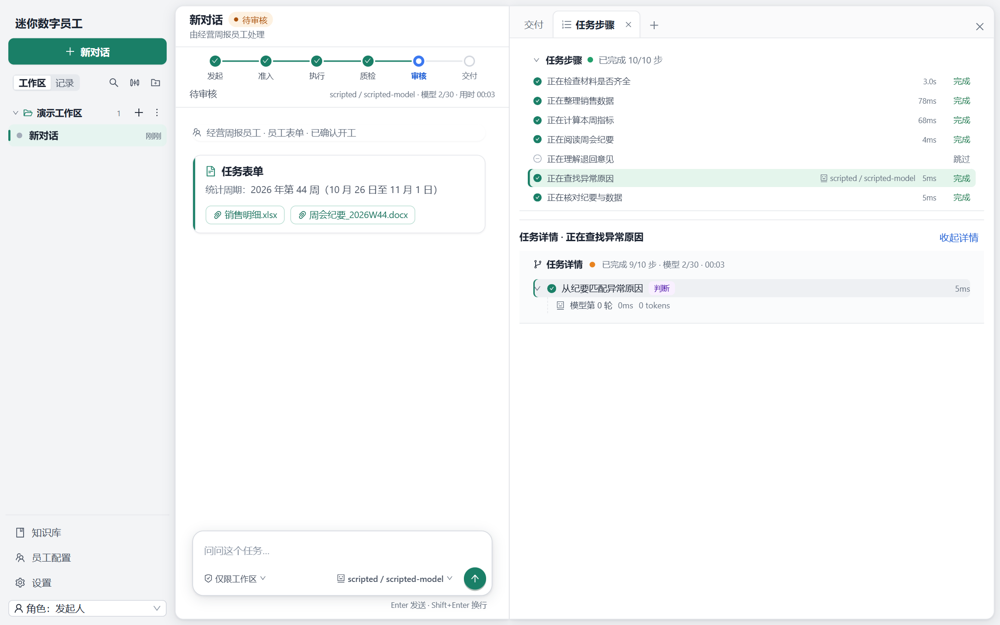
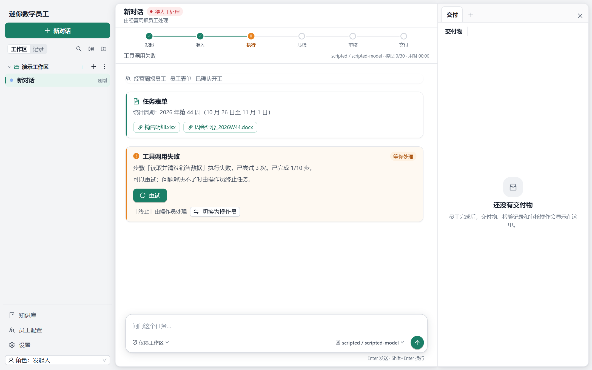
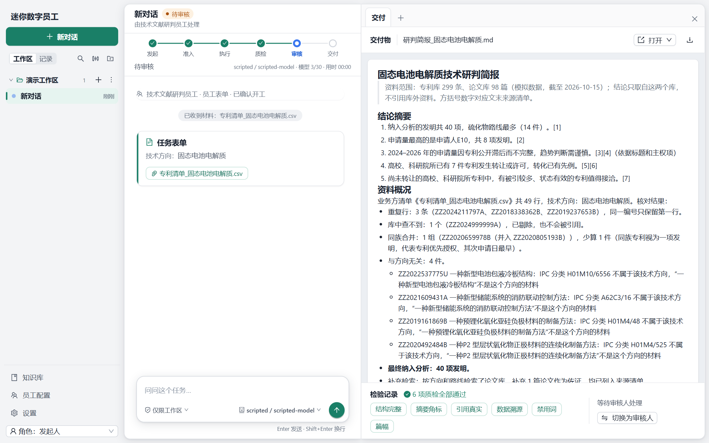
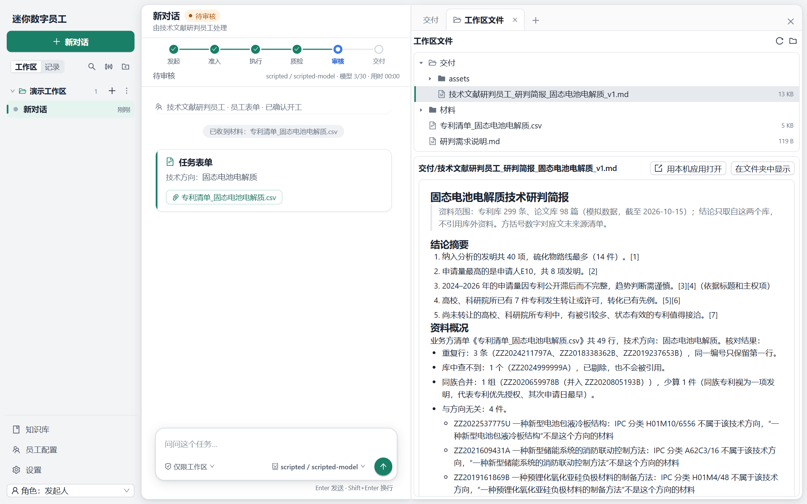
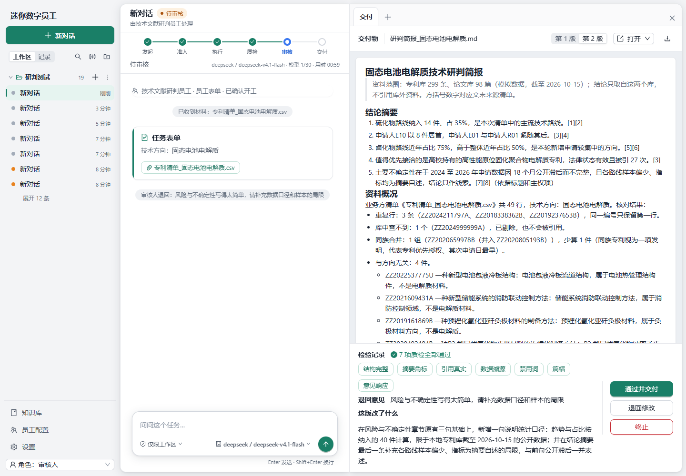
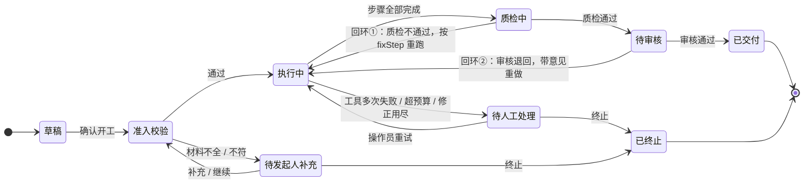

# 迷你数字员工

> 能接收岗位任务、调用工具产出交付物、交付前接受人工审核的数字员工系统。
> **程序管流程，模型做判断，人做决定。** 一个员工一套配置，换配置就换岗位。

两个业务员工共用同一个引擎：

| 员工 | 输入 | 交付物 |
|---|---|---|
| **经营周报员工**（场景 A） | 统计周期 + 销售明细 + 周会纪要 | 符合格式要求、带表格和图表的 Word 周报 |
| **技术文献研判员工**（场景 B） | 技术方向 + 业务方的专利清单 | 每条结论带引用角标的研判简报（Markdown + 图表） |

另有一个**知识库问答员工**，回答“以前的交付物里写了什么”。

使用方式：在对话里说一句要做什么，前台 Agent 找合适的员工、整理好字段和材料，弹出一张员工表单；人核对后点“确认开工”，员工按固定步骤干活，质检不过自己改，最后交给审核人通过或退回。

- 打包成一个约 28MB 的 exe，双击打开原生窗口，不用装运行时。
- 不预置任何模型厂商：在设置里自己添加 OpenAI 兼容的连接。
- 不填 Key 也能用剧本模型离线演示。

---

## 界面

以下都是程序真实运行时的截图。1–6 用剧本模型（不联网），7 用真实模型 `deepseek-v4.1-flash`。

**1. 欢迎页**：可以直接找员工，也可以说一句话让前台安排，或者一键载入公开样例。

<p align="center"></p>

**2. 经营周报待审核**：
- 左边是对话，顶部是状态轨迹（发起 → 准入 → 执行 → 质检 → 审核 → 交付），下面是任务表单。
- 右栏预览生成的 Word 周报，下方是检验记录（7 项质检全部通过），以及等待审核人处理的提示。

<p align="center"></p>

**3. 任务步骤**：右栏“任务步骤”标签页列出 10 个步骤的耗时和状态。首轮会跳过“理解退回意见”这一步。点任意一步，可以看到它的详情：判断步骤用了哪个模型、几轮、多少 token。

<p align="center"></p>

**4. 工具故障**：“读取并清洗销售数据”这一步已经重试了 3 次，任务停在执行中，状态是“待人工处理”。卡片上写明原因，提供“重试”按钮；终止需要切换为操作员才能做。这里的故障是在“演示与调试”里注入的。

<p align="center"></p>

**5. 技术文献研判简报待审核**：
- 简报开头是资料范围和结论摘要，每条结论都带引用角标。
- 资料概况列出清单核对的结果：重复行、库中查不到的、同族合并的、与方向无关的。
- 检验记录显示 6 项质检全部通过。

<p align="center"></p>

**6. 工作区文件**：右栏“工作区文件”标签页可以浏览这个会话的工作区目录（交付、材料、业务方清单），预览文件，或者用本机应用打开。

<p align="center"></p>

**7. 真实模型下的退回重做**：
- 审核人退回时写了“风险与不确定性写得太简单”，员工生成了第 2 版。
- 右上角可以在第 1 版和第 2 版之间切换。
- 质检多了一项“意见响应”，共 7 项全部通过。
- 下方是退回意见，以及“这版改了什么”。

<p align="center"></p>

---

## Loop 是怎么设计的

整个系统可以看成**两层循环**：

```
人 ──说话──▶ 前台 Agent 循环（对话层：理解需求、找文件、填表单）
                    │ run_employee → 员工表单卡 → 人点“确认开工”
                    ▼
             员工任务循环（执行层：程序按步骤编排，模型只在判断步骤里工作）
                    │ 质检 → 待审核 → 人通过 / 退回
                    ▼
                 交付物
```

设计时定下的原则是：**能用程序判定的不交给模型，必须由人拍板的不交给 Agent**。

| 谁 | 负责什么 |
|---|---|
| 程序 | 状态流转、步骤顺序、计算与统计、质检判定、预算与重试、权限校验、事件日志 |
| 模型 | 理解对话；在判断步骤里匹配原因、判断相关性和路线归类、写叙述、解读退回意见 |
| 人 | 确认开工、补材料、审核通过或退回、暂停后重试或终止 |

### 1. 员工任务循环：一条主线，两个回环



- **主线**：草稿 → 准入校验 → 执行中 → 质检中 → 待审核 → 已交付。
- **回环①：质检自动修正。** 质检规则由程序判定，例如数字能否对上事实、引用是不是原文、章节是否齐全、篇幅是否超限。不通过时，按 `qcFixSteps` 回到对应的判断步骤，把具体问题交给模型改。最多改 3 次，用尽后转人工处理。
- **回环②：审核退回重做。** 审核人可以按章节勾选退回，并写下意见。员工带着意见重跑判断步骤，生成新版本，旧版本保留可以对比。重做后的质检多一项“意见响应”。
- **出错时停下来，而不是编造。**
  - 准入校验不通过，或者清单与方向不符、资料不足，会暂停，等发起人补充。
  - 工具调用按配置退避重试（周报是 3 次），仍然失败就暂停，转人工处理。
  - 模型调用次数和时长有任务级预算（周报是 30 次、600 秒），超出也暂停。
  - 所有暂停都说明原因，修好后可以从失败的那一步接着跑。
- **状态表之外的流转一律拒绝**，并写一条 `transition_rejected` 事件。越权操作同样会留痕。三种角色是发起人、审核人和操作员，由服务端校验。

### 2. 步骤：计算交给工具，判断交给模型

每个员工的 `workflow.yaml` 是一串步骤，每步写明 `kind`：

- `compute`：直接调用进程内的工具，结果是确定的。
- `judge`：交给模型。
- `qc`：质检。

步骤的输入用 `$form.*`、`$steps.<步骤>.*`、`$config.*` 引用前面的结果，**模型看不到它不该看的东西**。

经营周报员工共 10 步，只有 3 步交给模型：

| # | 步骤 | 类型 |
|---|---|---|
| 1 | 准入校验（材料是否齐全、周期是否完整） | 计算 |
| 2 | 读取并清洗销售数据 | 计算 |
| 3 | 计算指标与异常（环比、毛利率、达成率、超阈值的区域和门店） | 计算 |
| 4 | 解析周会纪要 | 计算 |
| 5 | 解读退回意见（只在重做时执行） | **判断** |
| 6 | 从纪要匹配异常原因，抽取可核验的说法 | **判断** |
| 7 | 判定纪要与数据是否矛盾（按阈值算） | 计算 |
| 8 | 撰写周报叙述 | **判断** |
| 9 | 生成 Word（表格和图表由程序画） | 计算 |
| 10 | 质检 | 质检 |

技术文献研判员工同样是 10 步，3 步交给模型：

- 计算步骤：准入校验 → 清单核对（去重、库中查不到、同族合并）→ 程序判定纳入范围 → 统计路线、趋势、申请人和转化线索 → 检索佐证论文 → 渲染 Markdown → 质检。
- 判断步骤：逐条判断相关性、路线归类、写简报。

**数字和引用不让模型写。**
- 周报叙述里的数字写成槽位（如 `{{company.revenue}}`、`{{regions.华南.wow}}`），由程序从事实表填入。引用纪要原文时必须照抄原文的连续片段。
- 研判简报里，模型每句话只给出处编号（专利或论文 id），角标 `[1]` 和来源清单都由程序生成。
- 模型如果写了裸数字、编了引用，质检会抓出来，退回去改。

### 3. 判断步骤内部：带 Schema 的小循环

一个判断步骤就是一个受限的 Agent 循环：

1. 系统提示由员工的 `SKILL.md` 和该步骤的 `prompts/*.md` 组成；输入是上面引用到的数据。
2. 模型只能用这一步开放的只读工具（大多数步骤一个都不开），外加一个 `submit_result`。
3. `submit_result` 的参数按这一步的 `schemas/*.json` 校验：
   - 合法，这一步结束。
   - 不合法，把具体的错误作为工具结果退回给模型，让它改了再交。
4. 轮次（周报是每步 6 轮）和时长（每步 90 秒）有上限。用尽仍然没有合法结果，就记为 `invalid_output`，交给任务级的重试或暂停处理。

### 4. 前台 Agent 循环：对话、工具与权限关口

前台 Agent 是一个通用对话 Agent，按“调用模型 → 执行工具 → 再调用模型”循环，回复逐字显示，随时可以停止。

- **工具**：
  - 读工作区：`list_files`、`read_file`、`find_files`、`search_content`。
  - 写工作区：`write_file`、`edit_file`。
  - 待办清单 `todo_write`，向人提问 `ask_user_question`，命令行 `shell`。
  - **员工本身也是工具**：`run_employee`。
- **员工表单卡**：
  - `run_employee` 不会直接开工，而是弹出一张员工表单，标出哪些字段是 Agent 预填的、材料来自哪里。
  - 人可以修改字段、补传材料。必需项没备齐时，“确认开工”是灰的，鼠标停在上面会提示缺什么。
  - 点“取消”，Agent 会先问人想怎么调整，不会原样再发一张。
- **权限模式**（输入框左下角，每个会话各自记住）：

| 动作 | 仅可查看 | 仅限工作区（默认） | 完全权限 |
|---|---|---|---|
| 读、列、搜工作区文件 | 允许 | 允许 | 允许 |
| 写工作区内的文件 | 拒绝 | 允许并留痕 | 允许 |
| 运行员工 | 拒绝 | 一定弹表单由人确认 | 表单完整时直接开工 |
| 运行命令 `shell` | 拒绝 | 每次问 | 放行并留痕 |

无论哪种模式，下面这些边界都不变：
- 写操作只限工作区目录内，“交付”“材料”文件夹和隐藏文件不能写。
- 审核、重试、终止只有人能做。

> **`shell` 没有沙箱**：命令以本程序的用户身份运行，能触达工作区之外。真正的边界只有权限模式：“仅限工作区”下每条命令都要人看过再点“允许一次”。

- **上下文自动压缩**：
  - **每轮开始前**：估算要发给模型的量。超过模型上下文窗口（设置里按模型配置，缺省 128K）减去输出上限后的 70% 时，就把较早的对话压成摘要写进会话日志，保留最近 6 句原话。
  - **一轮之中**：工具结果攒到 85% 时，先截短较早的工具结果，还不够再丢最早的原文。

### 5. 可恢复：一切都是事件

- 每个任务在自己的目录里追加写 `events.jsonl`：状态变化、步骤开始和结束、每次模型调用、工具调用、质检结果、人的操作都在里面。
- 进程被杀后重启，程序重放事件、恢复状态，**只重跑没完成的步骤**，已完成的判断不会重新调用模型。
- 写文件类工具用“任务 + 步骤 + 输入哈希”做幂等。
- `replay` 子命令可以按时间回放任意任务。

---

## 快速开始

### 命令速查

PowerShell，在仓库根目录执行。只有构建机需要以下环境：Windows 10 / 11 x64、Go 1.27.3+、Bun 1.4+。

```powershell
# ── 打包成可执行文件 ──────────────────────────────────────────
$env:GOSUMDB='sum.golang.org'; $env:GOTOOLCHAIN='auto'          # 本机若关了校验库，先设这两个
bun install                                                      # 前端依赖（仅首次）
powershell -ExecutionPolicy Bypass -File scripts\build-exe.ps1   # → dist\digital-employee.exe（GUI 版，含前端构建）
bun run build:exe                                                # 同上的简写

# ── 启动 ─────────────────────────────────────────────────────
.\dist\digital-employee.exe                    # 双击同款：原生窗口，关窗即退出
.\dist\digital-employee.exe --browser          # 用浏览器代替窗口
.\dist\digital-employee.exe --serve-only       # 只起服务端
$env:DE_APP_DIR='D:\de-test\app'; .\dist\digital-employee.exe                     # 隔离数据，不碰日常数据
$env:DE_SCRIPTED='samples\cases\scripts\A-01.json'; .\dist\digital-employee.exe   # 不填 Key 的离线演示

# ── 从源码运行（开发）────────────────────────────────────────
bun run build:web                              # go:embed 需要 packages\web\dist
go run ./cmd/digital-employee                  # 控制台版；--browser / --serve-only 同上
go run ./cmd/digital-employee --serve-only     # 前端热更新：先起服务端，再开一个终端 ↓
$env:VITE_API_TARGET='http://localhost:8787'; bun run dev:web   # http://localhost:5173

# ── 测试 ─────────────────────────────────────────────────────
go test ./...                                  # 全部后端测试（剧本模型，不联网、不要 Key）
bun test packages/web                          # 前端测试
bun run typecheck                              # 前端类型检查
go run ./cmd/digital-employee run-cases "samples/cases/*.json" --scripted --out out/cases   # 43 条用例
powershell -ExecutionPolicy Bypass -File scripts\smoke-go.ps1   # 控制台版冒烟：A-01 + 起服务端 + SSE
```

### 1. 打包

```powershell
powershell -ExecutionPolicy Bypass -File scripts\build-exe.ps1
```

脚本做三件事：

1. 缺依赖时先 `bun install`，然后 `bun run --filter @de/web build` 构建前端，产物在 `packages/web/dist`，会被 `go:embed` 嵌进 exe。
2. `go build -trimpath -ldflags "-s -w -H=windowsgui -X main.appVersion=<版本>" -o dist/digital-employee.exe ./cmd/digital-employee`。
   - `-H=windowsgui` 表示 GUI 子系统，双击没有黑色控制台窗口。
   - 图标和版本信息在已入库的 `resource_windows_amd64.syso` 里，构建时自动链接。
3. 打印体积和 PE Subsystem，不是 GUI(2) 就报失败。脚本不会运行产出的 exe。

产物是 **`dist\digital-employee.exe`**，单文件，约 28MB，里面包括服务端、前端、员工配置和公开样例。分发时只用拷这一个文件。

**手动分步**（适合 CI 或自定义）：

```powershell
bun install
bun run --filter @de/web build
go build -trimpath -ldflags "-s -w -H=windowsgui" -o dist/digital-employee.exe ./cmd/digital-employee
```

| 参数 / 脚本 | 作用 |
|---|---|
| `build-exe.ps1 -SkipFrontend` | 已有前端产物时跳过前端构建 |
| `build-exe.ps1 -Version 0.2.0` | 指定版本号 |
| `scripts\build-go.ps1` | 构建控制台版 `dist\digital-employee-console.exe`，含冒烟。脚本或 CI 要读输出和退出码时用它 |
| `scripts\smoke-go.ps1 -SkipBuild` | 控制台版冒烟：临时目录跑 A-01 到交付，再起服务端校验接口、首页和 SSE |
| `scripts\smoke-exe.ps1` | 对打包好的 exe 做 `init` → `run-case` → 起服务端检查 |
| `go run scripts\gen-icon.go` | 重新生成图标图案 |

| 构建问题 | 处理 |
|---|---|
| `checksum database disabled` / 拉不到 Go 工具链 | `$env:GOSUMDB='sum.golang.org'; $env:GOTOOLCHAIN='auto'` |
| `go:embed ... no matching files` | 先 `bun run build:web` |
| `bun: command not found` | 安装 Bun，把 `%USERPROFILE%\.bun\bin` 加进 PATH |
| 杀毒软件拦截构建或产物 | 把仓库目录和 `dist\` 加进白名单 |

### 2. 启动

**双击 `digital-employee.exe`** 会打开原生窗口：MyGo 加上系统自带的 WebView2，默认 1280×860。

- 内嵌服务端只监听 `127.0.0.1`，端口从 8787 开始，被占用就往后找。
- 关闭窗口就是退出程序，不留后台进程。
- 同一个应用目录只运行一个实例，再次双击会把已有窗口带到前台。
- 程序会记住窗口大小和位置。日志写在 `<应用目录>\logs\`。启动失败会弹消息框说明原因。

首次启动会准备**应用目录** `%APPDATA%\digital-employee-app`（可以用 `DE_APP_DIR` 改）：

| 位置 | 内容 |
|---|---|
| `settings.json` | 设置；全新安装时没有任何模型连接，也不含 Key |
| `employees\` / `samples\` | 默认员工配置和公开样例（已有文件不覆盖） |
| `workspaces.json` | 工作区登记；没有工作区时自动建「我的工作区」，对应 `文档\数字员工` |
| `sessions\` / `tasks\` | 会话和任务（各自的事件日志） |
| `knowledge\` | 知识库 |
| `logs\` | 日志 |

**常用启动参数**：

| 参数 / 环境变量 | 作用 |
|---|---|
| （无参数）/ `--window` | 原生窗口（双击就是这个） |
| `--browser` | 用默认浏览器打开 |
| `--serve-only` / `DE_NO_OPEN=1` | 只起服务端 |
| `--port <端口>` / `DE_PORT` | 首选端口（默认 8787，被占用自动往后找） |
| `--host <地址>` | 监听地址（窗口模式固定 `127.0.0.1`；`--browser` / `--serve-only` 缺省监听所有网卡） |
| `DE_APP_DIR` | 应用目录 |
| `--workspace <目录>` / `DE_WORKSPACE` | 单目录模式：这个目录既是应用目录也是唯一的工作区（命令行用例这样用） |
| `DE_SCRIPTED` | 剧本模型文件（离线演示和测试） |
| `DE_FONT_PATHS` | 图表中文字体路径（不设则用系统字体） |
| `init` / `--version` | 只准备应用目录 / 打印版本 |

exe 是 GUI 子系统。从终端运行 `run-cases` 等子命令时，PowerShell 不会等它结束：可以在命令末尾加 `| Out-Host`，或者改用控制台版 `digital-employee-console.exe`，也可以用 `go run`。

| 启动问题 | 处理 |
|---|---|
| 弹框说缺少 WebView2 Runtime | 安装 [Microsoft Edge WebView2 Runtime](https://developer.microsoft.com/microsoft-edge/webview2/)（Windows 11 自带）；暂时可以用 `--browser` |
| 双击后没反应 | 可能已经有实例在运行；或者看 `<应用目录>\logs\digital-employee.log` |
| SmartScreen 拦截 | 点“更多信息 → 仍要运行”（exe 未签名） |
| 想从头再来 | 关掉程序，删掉或改名应用目录，或者换一个 `DE_APP_DIR` |

### 3. 第一次使用

1. 打开**设置 → 模型连接 → 添加连接**，填名称、Base URL（任何 OpenAI 兼容的服务）和 Key，然后点**拉取模型**，勾选要用的模型并保存。可以再点**测试连接**确认。
2. 点 **+ 新对话**。输入框右下角选模型，左下角是权限模式（默认“仅限工作区”）。
3. 说一句“帮我出第 44 周的周报”，或者在欢迎页直接点员工、点**载入公开样例**。
4. 在**员工表单**里核对字段和材料，点**确认开工**。
5. 任务依次走过准入、执行、质检，到待审核。在右栏预览交付物，点“切换为审核人”（或在左下角切换角色），就可以**通过**或**退回**。
6. 交付物同时写进工作区的 `交付\` 文件夹。交付后可以在同一个会话里继续聊、换模型，或者说“再来一版”。

**没有 Key 也能演示**：

```powershell
$env:DE_SCRIPTED="$env:APPDATA\digital-employee-app\samples\cases\scripts\A-01.json"
.\dist\digital-employee.exe
```

---

## 员工配置

一个员工就是一个目录，员工的全部行为都写在配置里，不改代码：

```
employees/weekly-report/
├── SKILL.md          岗位职责与写作要求（判断步骤的系统提示词）
├── frontdesk.md      写给前台 Agent 的说明：这个员工做什么、什么时候调 run_employee
├── workflow.yaml     步骤列表、输入引用、预算、质检修正步骤
├── qc.yaml           质检规则、阈值、禁用词、自定义规则
├── checklist.yaml    开工清单（缺什么不能开工、哪些可以跳过）
├── form.schema.json  员工表单（run_employee 的输入定义）
├── form.ui.json      表单布局
├── prompts/*.md      各判断步骤的提示词
└── schemas/*.json    各判断步骤的输出 Schema
```

- 质检按 `qc.yaml` 里的 `profile` 选择一套检查：
  - 周报 7 项：结构完整、数据溯源、异常覆盖、引用真实、纪要矛盾覆盖、禁用指标、篇幅。
  - 研判简报 6 项：结构完整、摘要角标、引用真实、数据溯源、禁用词、篇幅。
  - 重做时两者都会多一项“意见响应”。
- 界面里的**员工配置**页可以编辑这些配置，并保留版本历史。运行中的任务继续使用启动时的配置副本。

---

## 目录结构

```
digital-employee/
├── cmd/digital-employee/   程序入口
├── internal/
│   ├── engine/             任务引擎：状态机、步骤编排、事件日志、断点恢复
│   ├── agent/              判断步骤执行器（OpenAI 兼容模型 + 剧本模型）
│   ├── session/            会话、前台 Agent 循环、权限模式、员工表单、上下文压缩
│   ├── qc/  literature/    质检与槽位渲染；场景 B 的清单核对、统计和质检
│   ├── tools/  render/     进程内工具与故障注入；纯 Go 生成 Word 和图表
│   ├── server/             REST + SSE、角色权限、设置
│   ├── contract/  config/  共享类型（唯一事实来源）、员工配置加载
│   └── app/  desktop/  cli/  settings/   应用目录、原生窗口、命令行、设置
├── packages/web/           React + antd 前端
├── packages/core/          前端契约类型（与 internal/contract 逐字段一致）
├── employees/              weekly-report / literature-brief / knowledge-qa
├── samples/                场景 A、B 样例数据；cases/ 是 43 条用例和剧本模型输出
├── scripts/                构建与冒烟脚本
└── docs/screenshots/       README 用的界面截图
```

后端是 Go（`net/http` + SSE），前端是 React/Vite + antd。工具在进程内调用，不另起子进程。

---

## 测试与结果

| 项目 | 结果 |
|---|---|
| 剧本模式用例（A 6 条 + S 24 条 + T 6 条 + B 7 条） | **43/43** 通过 |
| 场景 A 真实模型：A-01 至 A-05 各跑 3 次 | **444/444** 项判定要点通过 |
| 场景 B 真实模型（`deepseek-v4.1-flash`）：B-01 连跑 5 次 | **5/5** 走到待审核 |
| 场景 B 真实模型：其他用例 | B-02 通过；B-03、B-04、B-05 和“资料偏少”按期望暂停或拦住；退回重做生成第 2 版，7 项质检通过 |

- `go test ./...` 覆盖引擎、质检、模型、工具、渲染、服务端、会话和 CLI，全部用剧本模型，不联网。
- `bun test packages/web` 覆盖前端的纯函数和视图。
- 用例格式见 [samples/cases/README.md](samples/cases/README.md)。
- 场景 B 的专利、申请人、指标和论文都是为比赛模拟的数据，见 `samples/scenario-b/数据说明.md`。

---

## 已知限制

- 原生窗口只在 Windows 11 x64 上验证过。Windows 10 需要先装 WebView2 Runtime，否则用 `--browser`。
- exe 未签名，首次运行可能被 SmartScreen 拦一次。
- 字体没有嵌入：图表用系统中文字体（微软雅黑），完全没有中文字体的机器上图表会缺字。
- 升级 exe 后，应用目录里已有的 `employees\`、`samples\` 不会自动覆盖。要用新的默认配置，先备份再删除这两个目录。
- 真实供应商的流式输出只用本地假服务和 DeepSeek 验证过，接新供应商时先跑一遍手动测试。
- 退回重做会重写整篇，没有退回的章节措辞也可能略有变化。
- 角色通过 `x-role` 请求头声明，没有登录。部署到公网前必须在前面加鉴权。

---

术语的准确含义见 [术语表](GLOSSARY.md)。
